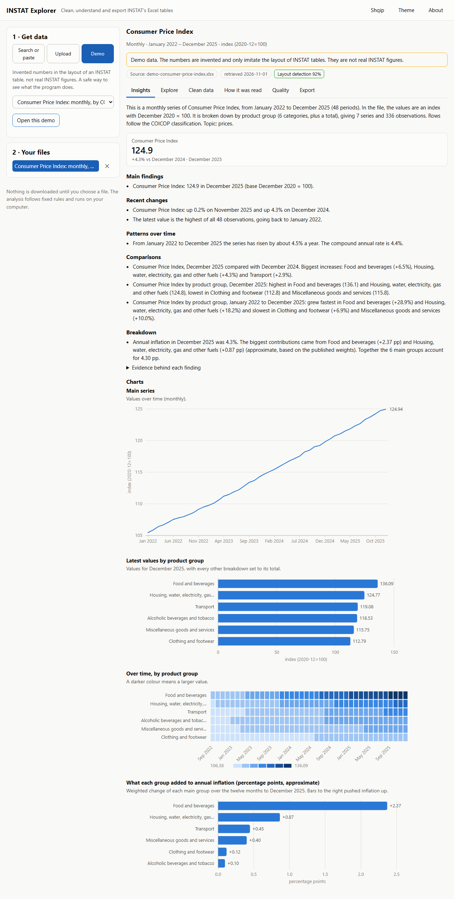
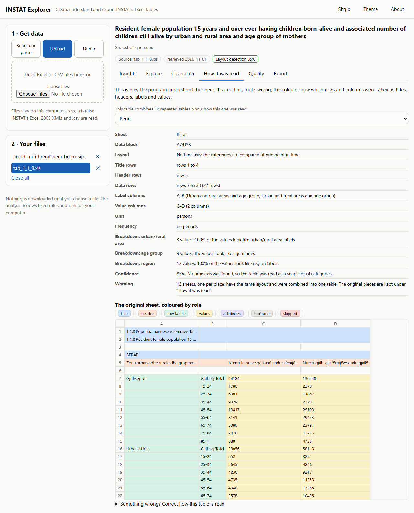

# INSTAT Explorer: a brief for INSTAT and the institutions that use its data

> INSTAT Explorer is an independent project. Nobody at INSTAT or in government has reviewed the program or this text. Every claim below is
> backed by the repository: see `EVIDENCE.md` and `LIMITATIONS.md`.

## The problem

INSTAT publishes about 640 Excel tables, made to be read by people. Titles are stacked in two languages, years are text (` 01-17`), headers run
across merged cells, footnotes sit among the data, and the census tables are old `.xls` files. Before a student, a journalist, a ministry
analyst or a researcher can use a table in a pivot table, R or Python, someone has to clean it by hand, every time, and each person
cleans it a little differently.

## What exists

A free, open-source (MIT) program that runs on the user's own computer, in English and in Albanian. It reads an INSTAT table, shows how it
understood the sheet (so the reader can check and correct it), produces one tidy row per number with the original cell reference
(`D7`) next to each, runs consistency checks, writes plain-language findings from fixed rules (no AI service, nothing leaves the computer),
and exports a self-contained report, CSV, Excel and SQLite files that name INSTAT as the source.

It needs no account and no administrator rights, runs on an old laptop, works offline except when the user asks it to fetch a file from
instat.gov.al, and ships for Windows as a double-click program.

*How it was read* shows the original sheet coloured by what the program decided each part is, so a reader can see and correct the reading.
This is a real INSTAT census table in the old `.xls` format: twelve sheets, one per prefecture, were combined into one table.

## What the evidence shows

(Details and method in `EVIDENCE.md`.)

* On **148 real INSTAT files** from 19 topic pages (118 of them every file on the non-census pages, 30 a sample of census tables), the
  program read 144 without a crash; the other 4 were links that no longer work on INSTAT's site. It found 276 tables with 118,483 observations.
  In **91 % of the tables and 89 % of the files no check failed**; the rest are marked on screen as *probably read wrongly*.
* **Compared with INSTAT's own press releases**: 149 figures from ten releases (consumer prices, GDP, labour force, wages, trade, building permits,
  births, tourism ...) were worked out from the Excel tables and compared with what INSTAT states. 140 are equal after rounding, 1 equal when INSTAT's
  rounded levels are used, 7 close (approximate by design) and 1 differs, a cell in INSTAT's own table. The comparison also found two reading defects in
  the program, now fixed, that no internal check could detect (`docs/PUBLISHED_COMPARISON.md`).
* 469 automated tests (90 % of the code), including the exact recovery of known numbers from seven synthetic workbooks that imitate INSTAT
  layouts, the handling of broken and hostile files, and the part that talks to the internet tested against played-back answers.
* Every screen checked in a real browser, in both languages, light and dark and at phone width, with no console error, failed request or
  security-policy violation (`tools/screenshots.py`; the pictures are in `docs/screenshots/`).
* Security and privacy by design: local only, an access token, no telemetry (see `SECURITY_AND_PRIVACY.md`).
* Contrast checked against WCAG 2.1 AA on 4,250 pieces of text per theme with no failures.

## What it is not, yet

(Details in `LIMITATIONS.md`.)

* Compared with INSTAT's published figures only for the headline figures of ten releases: "no check failed" is not "correct" (seven files were wrong
  and clean until that comparison). Not tested on most of INSTAT's 640 files.
* The Albanian has not been reviewed by a native speaker; accessibility has not been tested with a screen reader.
* The Windows files are unsigned (the build recipe is in the repository), and everything was tested on Windows only.
* Single-user; it does not replace a statistical database (it does not read PxWeb).

## What would turn it into something INSTAT can stand behind

1. **A test corpus from INSTAT**: the files INSTAT cares most about, with the published figures, so that "no check failed" can become
   "matches the publication", and the layouts INSTAT is about to change can be tested before they are published.
2. **A native-speaker review** of the Albanian interface and of the standard terms (a list of about 340 is in `instatkit/data/glossary_sq_en.csv`).
3. **An accessibility audit** with assistive technology, if the program is to be recommended to schools and offices.
4. **Code signing** of the Windows files, so that IT departments can allow them. The build is in this repository (`packaging/build_release.py`); the signing certificate is what is missing.
5. **A decision on ownership and naming**: who maintains it, whether INSTAT wants to link to it or host it, and the wording that keeps
   it clear that it is an independent tool. The licence (MIT) already allows INSTAT to adopt, change and redistribute it.
6. **A pilot** with a school, a university department and an office that uses INSTAT data, to learn which of the remaining layouts matter.

None of this needs the program to change shape. It is about checking it against the people who know the data best.

## Contact

JXH-DEV · https://github.com/JXH-DEV/Instat-Statistical-Tool
